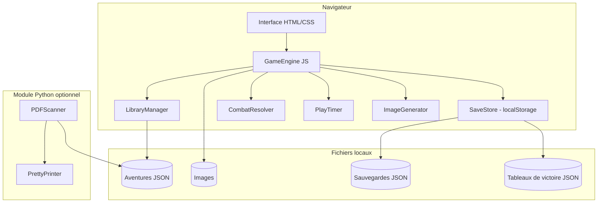

# Document de Design Technique — Moteur de Gamebook

## Vue d'ensemble

Le moteur de gamebook est une application locale permettant de jouer à des livres-jeux interactifs de type "Dont vous êtes le héros". Il charge des aventures décrites en JSON, gère la progression du joueur (statistiques, inventaire, combats), sauvegarde les parties et enregistre les victoires dans un tableau de scores.

L'application est réalisée en **HTML/JavaScript** (frontend pur, sans serveur), avec un module Python optionnel pour le scan de PDF. Elle fonctionne entièrement en local via un navigateur web.

### Objectifs de design

- Zéro dépendance serveur : tout tourne dans le navigateur via `file://` ou un simple serveur statique
- Format JSON ouvert et documenté pour les aventures
- Séparation claire entre le moteur (logique), les données (aventures JSON) et l'interface (HTML/CSS/JS)
- Module Python autonome pour le scan PDF → JSON

---

## Architecture



### Flux principal

1. Au démarrage, `LibraryManager` scanne le répertoire d'aventures et charge les métadonnées
2. Le joueur sélectionne une aventure → `GameEngine` initialise ou restaure une `GameSession`
3. `GameEngine` affiche les sections, résout les choix, délègue les combats à `CombatResolver`
4. `PlayTimer` mesure le temps de jeu actif
5. `SaveStore` persiste l'état via `localStorage` (ou fichiers JSON via l'API File System Access)
6. En cas de victoire, le score est enregistré dans le tableau de victoire

---

## Composants et Interfaces

### GameEngine

Composant central orchestrant la session de jeu.

```typescript
interface GameEngine {
  loadAdventure(adventure: Adventure): void
  startNewGame(): void
  resumeGame(save: SaveState): void
  navigateTo(sectionNumber: number): void
  applyChoice(choice: Choice): void
  saveGame(): void
  endGame(victory: boolean): void
}
```

### LibraryManager

Gère la découverte et le chargement des aventures disponibles.

```typescript
interface LibraryManager {
  scanDirectory(path: string): Promise<AdventureMetadata[]>
  loadAdventure(path: string): Promise<Adventure>
  validateAdventure(data: unknown): ValidationResult
}
```

### CombatResolver

Résout les combats selon les règles de l'aventure.

```typescript
interface CombatResolver {
  resolve(hero: Hero, enemy: Enemy, rules: CombatRules): CombatResult
  rollDice(sides: number, count: number): number[]
}
```

### SaveStore

Persiste et restaure les états de jeu.

```typescript
interface SaveStore {
  save(adventureId: string, state: SaveState): void
  load(adventureId: string): SaveState | null
  hasSave(adventureId: string): boolean
  deleteSave(adventureId: string): void
  getLeaderboard(adventureId: string): LeaderboardEntry[]
  addLeaderboardEntry(adventureId: string, entry: LeaderboardEntry): void
}
```

### PlayTimer

Mesure le temps de jeu actif (s'arrête lors des pauses/sauvegardes).

```typescript
interface PlayTimer {
  start(): void
  pause(): void
  resume(): void
  getElapsedMs(): number
  reset(): void
}
```

### ImageGenerator

Génère des illustrations via un service d'IA gratuit (ex. Pollinations.ai).

```typescript
interface ImageGenerator {
  generateForSection(adventure: Adventure, section: Section): Promise<string>
  buildPrompt(adventure: Adventure, section: Section): string
}
```

### PDFScanner (Python)

Module Python autonome pour convertir un PDF de livre-jeu en JSON.

```python
class PDFScanner:
    def scan(self, pdf_path: str) -> Adventure: ...
    def extract_sections(self, pages: list[Page]) -> list[Section]: ...
    def extract_images(self, pages: list[Page]) -> dict[int, str]: ...
    def extract_intro_pages(self, pages: list[Page]) -> IntroData: ...

class PrettyPrinter:
    def format(self, adventure: Adventure) -> str: ...  # JSON indenté
```

---

## Modèles de données

### Format JSON d'aventure

```json
{
  "titre": "Le Sorcier de la Montagne de Feu",
  "tags": ["fantasy", "classic", "fighting-fantasy"],
  "repertoire_images": "adventures/sorcier/images/",
  "image_de_garde": "cover.jpg",
  "mode_emploi": "Texte des règles de base...",
  "images_annexes": ["carte.jpg", "tableau_combat.jpg"],
  "personnage": {
    "statistiques": {
      "habilete": { "valeur": 0, "init": "2d6+6", "label": "Habileté" },
      "endurance": { "valeur": 0, "init": "2d6+12", "label": "Endurance" },
      "chance": { "valeur": 0, "init": "1d6+6", "label": "Chance" }
    },
    "inventaire": ["Épée", "Bouclier", "10 Pièces d'or"]
  },
  "regles": {
    "combat": {
      "type": "fighting-fantasy",
      "des_attaque": 2,
      "formule_force_attaque": "habilete + roll",
      "degats_victoire": 2,
      "degats_defaite": 2
    },
    "victoire": { "sections": [400] },
    "defaite": { "endurance_min": 0 }
  },
  "sections": [
    {
      "numero": 1,
      "texte": "Vous vous réveillez dans une auberge...",
      "image": "section1.jpg",
      "choix": [
        { "texte": "Partir vers le nord", "section": 42 },
        { "texte": "Rester à l'auberge", "section": 17 }
      ]
    },
    {
      "numero": 14,
      "texte": "Un gobelin vous attaque !",
      "combat": {
        "nom": "Gobelin",
        "habilete": 5,
        "endurance": 4
      },
      "choix": [
        { "texte": "Continuer", "section": 23 }
      ]
    }
  ]
}
```

### Modèles TypeScript internes

```typescript
interface Adventure {
  titre: string
  tags: string[]
  repertoire_images: string
  image_de_garde: string
  mode_emploi: string
  images_annexes?: string[]
  personnage: PersonnageTemplate
  regles: Regles
  sections: Section[]
}

interface Section {
  numero: number
  texte: string
  image?: string
  combat?: CombatData
  effets?: Effet[]
  choix: Choice[]
}

interface Choice {
  texte: string
  section: number
  condition?: string  // expression évaluable optionnelle
}

interface Hero {
  statistiques: Record<string, number>
  inventaire: string[]
  historique: StatChange[]
}

interface StatChange {
  timestamp: number
  stat: string
  delta: number
  raison: string
}

interface SaveState {
  adventureId: string
  sectionCourante: number
  hero: Hero
  tempsJeuMs: number
  timestamp: number
}

interface LeaderboardEntry {
  nom: string
  tempsJeuMs: number
  date: string
}

interface ValidationResult {
  valid: boolean
  errors: string[]
}

interface CombatResult {
  victoire: boolean
  rounds: CombatRound[]
  heroEnduranceFinale: number
}

interface CombatRound {
  numero: number
  rollHero: number[]
  rollEnnemi: number[]
  forceAttaqueHero: number
  forceAttaqueEnnemi: number
  degats: number
  cible: 'hero' | 'ennemi'
}
```

### Structure des fichiers de sauvegarde

Les sauvegardes sont stockées dans `localStorage` avec les clés suivantes :

- `save:{adventureId}` → `SaveState` (JSON)
- `leaderboard:{adventureId}` → `LeaderboardEntry[]` (JSON)

Pour les navigateurs supportant l'API File System Access, les sauvegardes peuvent être exportées/importées en fichiers JSON.

---

## Correctness Properties

*Une propriété est une caractéristique ou un comportement qui doit rester vrai pour toutes les exécutions valides d'un système — essentiellement, un énoncé formel de ce que le système doit faire. Les propriétés servent de pont entre les spécifications lisibles par l'humain et les garanties de correction vérifiables par machine.*

### Property 1 : Round-trip de sérialisation d'aventure

*Pour tout* objet `Adventure` valide, le sérialiser en JSON puis le désérialiser doit produire un objet équivalent à l'original.

**Validates: Requirements 11.7**

### Property 2 : Validation des champs obligatoires

*Pour tout* objet JSON d'aventure auquel on retire au moins un champ obligatoire parmi (`titre`, `tags`, `repertoire_images`, `image_de_garde`, `mode_emploi`, `personnage`, `regles`, `sections`), `validateAdventure` doit retourner `valid: false` et le message d'erreur doit mentionner le nom du champ manquant.

**Validates: Requirements 1.1, 1.3, 1.4, 1.5**

### Property 3 : Intégrité de la sauvegarde (round-trip)

*Pour tout* état de jeu `SaveState` (section courante, statistiques du héros, inventaire, temps de jeu), sauvegarder puis charger cet état doit produire un objet identique à l'original sans perte de données.

**Validates: Requirements 7.2, 7.4, 9.4**

### Property 4 : Invariant du chronomètre

*Pour toute* séquence de démarrages et pauses du `PlayTimer`, le temps cumulé retourné par `getElapsedMs()` doit être strictement croissant pendant les phases actives et constant pendant les phases de pause.

**Validates: Requirements 8.1, 8.2**

### Property 5 : Construction du prompt IA

*Pour toute* aventure et toute section, le prompt généré par `ImageGenerator.buildPrompt()` doit contenir le titre de l'aventure, au moins un tag de l'aventure, et une portion non vide du texte de la section.

**Validates: Requirements 10.2**

### Property 6 : Extraction des sections PDF

*Pour tout* document PDF synthétique contenant N sections numérotées distinctes, le `PDFScanner` doit extraire exactement N sections, chacune ayant un `numero` unique et un `texte` non vide.

**Validates: Requirements 11.1, 11.2**

### Property 7 : Tableau de victoire — enregistrement et tri

*Pour toute* liste d'entrées de victoire (nom, temps de jeu) ajoutées dans un ordre quelconque, le tableau de victoire retourné par `SaveStore.getLeaderboard()` doit contenir toutes les entrées et être trié par temps de jeu croissant.

**Validates: Requirements 9.2, 9.3, 9.4**

### Property 8 : Historique des modifications de statistiques

*Pour toute* séquence de modifications de statistiques du héros (delta, raison), l'historique `hero.historique` doit contenir exactement autant d'entrées que de modifications appliquées, dans l'ordre chronologique.

**Validates: Requirements 5.4**

### Property 9 : Règles de combat

*Pour tout* combat entre un héros et un ennemi avec des statistiques aléatoires, la force d'attaque calculée par `CombatResolver` doit toujours être égale à `habilete + somme_des_dés`, et les dégâts appliqués au perdant de chaque round doivent correspondre exactement aux règles définies dans l'aventure.

**Validates: Requirements 6.2, 6.4**

---

## Gestion des erreurs

| Situation | Comportement attendu |
|-----------|---------------------|
| Fichier JSON d'aventure invalide | Message d'erreur avec nom du fichier et nature du problème ; les autres aventures continuent de se charger |
| Champ obligatoire manquant | `ValidationResult` avec liste des champs manquants |
| Section sans choix (non-finale) | Message d'erreur "section incomplète" affiché au joueur |
| Sauvegarde corrompue | Message d'erreur + proposition de nouvelle partie |
| Service IA indisponible | Message d'erreur + continuation sans image |
| PDF illisible ou non conforme | Message d'erreur descriptif, pas de JSON partiel sans avertissement |
| Endurance du héros ≤ 0 | Écran de défaite + proposition de recommencer ou retourner à la bibliothèque |
| Aucune aventure trouvée | Message "répertoire vide ou introuvable" |

### Stratégie de validation

La validation des aventures se fait en deux passes :
1. **Validation structurelle** : présence des champs obligatoires, types corrects
2. **Validation sémantique** : cohérence des références de sections (les `section` dans les `choix` pointent vers des numéros existants)

Les erreurs de validation sont collectées et affichées toutes ensemble (pas d'arrêt au premier problème).

---

## Stratégie de tests

### Tests unitaires (JavaScript — Vitest ou Jest)

Couvrent les comportements spécifiques et les cas limites :

- `validateAdventure` : champs manquants, types incorrects, sections vides
- `CombatResolver.resolve` : victoire, défaite, calcul des dommages
- `PlayTimer` : démarrage, pause, reprise, cumul
- `SaveStore` : sauvegarde, chargement, absence de sauvegarde, corruption
- `ImageGenerator.buildPrompt` : contenu du prompt
- Navigation : section avec choix, section sans choix, section de victoire

### Tests de propriétés (JavaScript — fast-check)

Chaque propriété du document est couverte par un test property-based avec minimum 100 itérations.

La bibliothèque choisie est **[fast-check](https://fast-check.dev/)** (TypeScript/JavaScript).

- **Feature: gamebook-engine, Property 1** : Round-trip sérialisation Adventure
  - Générateur : `fc.record({ titre: fc.string(), sections: fc.array(...), ... })`
  - Assertion : `deserialize(serialize(adventure))` équivalent à `adventure`

- **Feature: gamebook-engine, Property 2** : Validation champs obligatoires
  - Générateur : objets JSON valides avec un ou plusieurs champs obligatoires retirés aléatoirement
  - Assertion : `validateAdventure(obj).valid === false` et `errors` contient le nom du champ manquant

- **Feature: gamebook-engine, Property 3** : Intégrité sauvegarde round-trip
  - Générateur : `fc.record({ sectionCourante: fc.integer({min:1}), hero: ..., tempsJeuMs: fc.nat() })`
  - Assertion : `load(save(state))` équivalent à `state`

- **Feature: gamebook-engine, Property 4** : Invariant chronomètre
  - Générateur : séquences d'intervalles start/pause avec durées aléatoires (simulées via mock de Date.now)
  - Assertion : temps cumulé strictement croissant pendant les phases actives, constant pendant les pauses

- **Feature: gamebook-engine, Property 5** : Contenu du prompt IA
  - Générateur : aventures et sections aléatoires (titre non vide, tags non vides, texte non vide)
  - Assertion : prompt contient `adventure.titre`, au moins un tag, et une portion de `section.texte`

- **Feature: gamebook-engine, Property 7** : Tableau de victoire — enregistrement et tri
  - Générateur : listes d'entrées `{nom: fc.string(), tempsJeuMs: fc.nat()}` dans un ordre aléatoire
  - Assertion : `getLeaderboard()` contient toutes les entrées et est trié par `tempsJeuMs` croissant

- **Feature: gamebook-engine, Property 8** : Historique des modifications de statistiques
  - Générateur : séquences de modifications `{stat: fc.string(), delta: fc.integer(), raison: fc.string()}`
  - Assertion : `hero.historique.length === modifications.length` et ordre préservé

- **Feature: gamebook-engine, Property 9** : Règles de combat
  - Générateur : héros et ennemis avec `habilete` et `endurance` aléatoires, résultats de dés mockés
  - Assertion : `forceAttaque === habilete + rollTotal` et dégâts correspondent aux règles de l'aventure

- **Feature: gamebook-engine, Property 6** : Extraction sections PDF (Python — Hypothesis)
  - Bibliothèque : **[Hypothesis](https://hypothesis.readthedocs.io/)** (Python)
  - Générateur : PDFs synthétiques avec N sections numérotées (N entre 1 et 400)
  - Assertion : `len(scanner.extract_sections(pages)) == N`, numéros uniques, textes non vides

### Tests d'intégration

- Chargement complet d'une aventure JSON réelle depuis le disque
- Cycle complet : démarrage → navigation → combat → victoire → tableau de victoire
- Scan PDF → JSON → rechargement (round-trip complet)

### Tests de fumée (smoke tests)

- L'application s'ouvre dans le navigateur sans erreur console
- La bibliothèque affiche les aventures du répertoire de test
- Le module Python `PDFScanner` s'importe sans erreur
